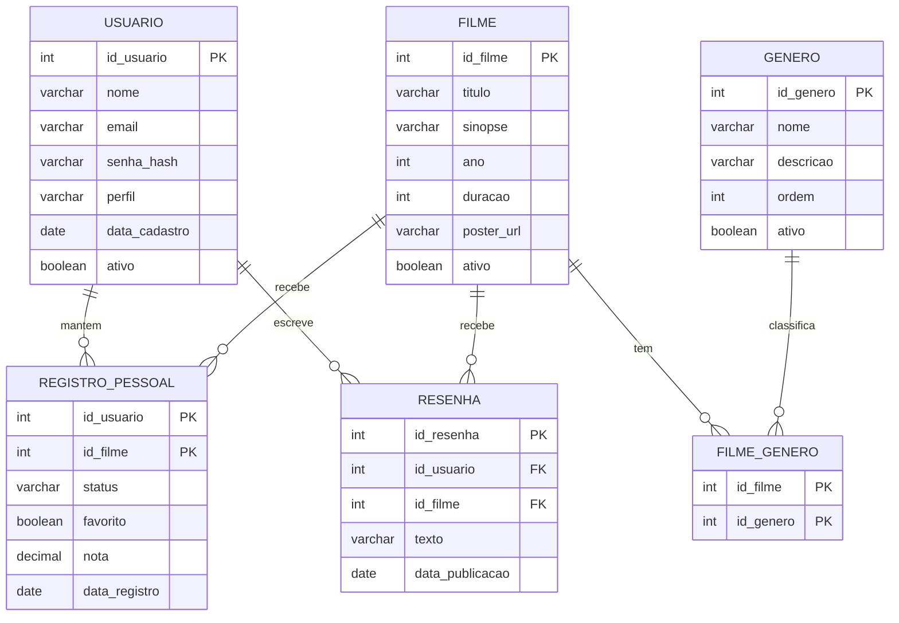

# Repositorio do Grupo Reelbook

## Integrantes

- João Victor de Jesus Silva
- Nicolle Lima
- Estella Garcia
- Felipe Maeta
# Descrição sobre o projeto

Reelbook é um site inspirado em redes sociais de filmes, criado para usuários amantes de cinema que desejam avaliar, trocar opiniões, organizar e registrar seus filmes favoritos.

O ReelBook foi pensado para tornar a experiência de descobrir e acompanhar filmes mais divertida e pessoal. A plataforma permitirá que os usuários pesquisem títulos, conheçam mais sobre cada filme, façam suas próprias avaliações, criem listas personalizadas e registrem os filmes que já assistiram.

O projeto é feito em Java (Servlets e JSP) com banco de dados H2. Para rodar: `mvn tomcat7:run` e acessar `http://localhost:8080`.

# Divisão de Tarefas

Cada integrante entrega um CRUD completo (Model, DAO, Servlet e JSP) sobre o banco H2.

| Integrante | Tabela(s) | CRUD | Funcionalidades |
|---|---|---|---|
| Nicolle | `GENERO` + base do projeto | cadastrar, listar, renomear, desativar | estrutura Maven, conexão H2, home, identidade visual, filtro por gênero (10) |
| João | `FILME` + `FILME_GENERO` | cadastrar, listar/buscar, detalhar, editar, desativar | 1, 2, 3, 10 |
| Estella | `REGISTRO_PESSOAL` | adicionar à lista, ver favoritos/assistidos, mudar status e nota, remover | 4, 5, 6, 7, 9 |
| Felipe | `USUARIO` + `RESENHA` | cadastro, login/logout, perfil, escrever/editar/apagar resenha | 11, 12, 13, 14, 15 |

# Funcionalidades

1. Listar filmes — Exibir os filmes disponíveis.
2. Buscar filmes — Permitir que o usuário pesquise filmes pelo nome.
3. Visualizar detalhes do filme — Exibir informações como título, sinopse, gênero, ano, duração e avaliação.
4. Favoritar filmes — Permitir que o usuário adicione filmes aos favoritos.
5. Listar filmes favoritos — Exibir todos os filmes que o usuário favoritou.
6. Avaliar filmes — Permitir que o usuário dê uma nota para um filme.
7. Marcar filme como assistido — Permitir que o usuário registre os filmes que já assistiu.
8. Criar lista de filmes — Permitir que o usuário organize filmes em listas personalizadas.
9. Remover filmes dos favoritos — Permitir que o usuário retire um filme da lista de favoritos.
10. Filtrar filmes — Permitir filtrar por gênero, ano, nota.
11. Cadastrar usuário — Permitir a criação de uma conta.
12. Login e logout — Permitir que o usuário entre e saia da sua conta.
13. Perfil do usuário — Exibir informações e atividade do usuário.
14. Comentários/reviews — Permitir que o usuário escreva uma avaliação sobre um filme.
15. Visualizar avaliações — Exibir notas e comentários de outros usuários.
# Modelo de Dados (MER)

O banco de dados é o H2, com 6 tabelas criadas pelo arquivo [schema.sql](src/main/resources/schema.sql).

- **USUARIO**: contas do site; o `perfil` separa usuário comum de curador.
- **FILME**: catálogo de filmes (duração em minutos).
- **GENERO** e **FILME_GENERO**: gêneros e a ligação N:N com os filmes.
- **REGISTRO_PESSOAL**: o que cada pessoa fez com cada filme (`QUERO_ASSISTIR` ou `ASSISTIDO`, favorito e nota).
- **RESENHA**: texto que o usuário escreve sobre um filme.

# Páginas do Reelbook

- Tela inicial

- Perfil

- Favoritos

- Lista de Filmes

- Diário

